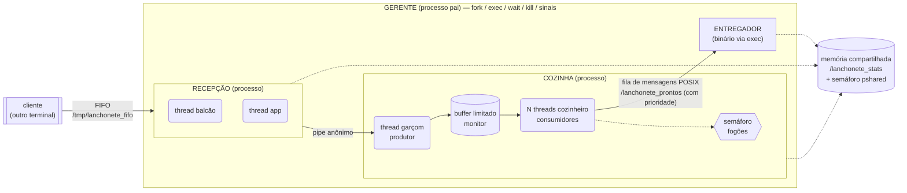

# Lanchonete Concorrente

Simulação de uma lanchonete em **C (POSIX / Linux)** em que cada setor do estabelecimento é um **processo** ou uma **thread**, que se comunicam e se sincronizam usando os principais mecanismos de **programação concorrente** e **IPC** estudados na disciplina.

> Projeto da disciplina de Sistemas Operacionais / Programação Concorrente.
> **Equipe:** Gabriele Lima, Barbara Kimberly Gonçalves, Jorge Luiz Lima

---

## Objetivo

Demonstrar, em uma aplicação prática e fácil de visualizar, o uso combinado de:

- **Processos** (`fork`, `exec`, `wait`, `exit`) e **threads POSIX** (`pthread_create`, `pthread_join`);
- **Sincronização**: mutexes, semáforos POSIX, variáveis de condição, exclusão mútua;
- **Comunicação entre processos (IPC)**: pipe anônimo, named pipe (FIFO), fila de mensagens POSIX, memória compartilhada POSIX e sinais;
- **Problemas clássicos**: produtor–consumidor com buffer limitado, monitor, recurso limitado (fogões) e **condição de corrida** com e sem solução.

A metáfora da lanchonete torna cada conceito concreto: pedidos são mensagens, o balcão da cozinha é um buffer limitado, os fogões são um recurso escasso e o caixa é uma seção crítica.

---

## Arquitetura



### Fluxo de um pedido

1. Um pedido nasce na **Recepção**: gerado automaticamente pela thread *balcão* ou enviado por um cliente externo (`./bin/cliente`) pelo **FIFO** e lido pela thread *app*.
2. A Recepção atribui um ID (protegido por **mutex**) e envia o pedido pelo **pipe anônimo** à Cozinha.
3. Na **Cozinha**, a thread *garçom* lê o pipe e deposita o pedido no **buffer limitado** (monitor). Se o buffer estiver cheio, ela **espera** (`pthread_cond_wait`).
4. Uma das **N threads cozinheiro** retira o pedido, **pega um fogão** (`sem_wait`). Se todos estiverem ocupados, ela espera. Depois prepara o pedido e **libera o fogão** (`sem_post`).
5. O pedido pronto vai para a **fila de mensagens POSIX**. Pedidos do app têm **prioridade 5** e os do balcão, prioridade 1.
6. O **Entregador**, um programa separado iniciado com `exec`, recebe o pedido (`mq_receive`) e registra a entrega e o faturamento na **memória compartilhada**.
7. O **Gerente** controla o expediente. Ao final (ou ao receber Ctrl+C), encerra tudo em ordem.

### Encerramento ordenado (graceful shutdown)

```
Gerente --SIGTERM--> Recepção  (threads param, write-end do pipe é fechado)
                     Cozinha   (garçom lê EOF -> buffer encerrado -> cozinheiros terminam
                                o que falta -> envia mensagem sentinela id = -1)
                     Entregador(recebe a sentinela -> termina)
Gerente: waitpid() em todos -> placar final -> shm_unlink / mq_unlink / unlink(FIFO)
```

Nenhum pedido aceito é perdido: tudo o que entrou no pipe é preparado e entregue antes do fechamento.

---

## Mecanismos utilizados

| Conceito | Onde | Como |
|---|---|---|
| `fork()` | `main.c` | Cria os processos Recepção, Cozinha e Entregador |
| `exec()` | `main.c` → `entregador.c` | `execl()` substitui a imagem do processo filho pelo binário `entregador` |
| `wait()` / `exit()` | `main.c` | `waitpid()` coleta o status de cada filho, que termina com `exit()` |
| `pthread_create` / `pthread_join` | `recepcao.c`, `cozinha.c` | 2 threads na recepção; 1 garçom + N cozinheiros na cozinha |
| **Mutex** (`pthread_mutex`) | `recepcao.c`, `cozinha.c` | Contador de IDs + escrita no pipe; buffer do monitor; contador de fogões em uso |
| **Variáveis de condição** (`pthread_cond`) | `cozinha.c` | `nao_cheio` e `nao_vazio` do buffer limitado; `broadcast` no encerramento |
| **Semáforo contador** (`sem_init` pshared=0) | `cozinha.c` | Fogões: no máximo *F* cozinheiros cozinham ao mesmo tempo |
| **Semáforo entre processos** (`sem_init` pshared=1) | `main.c` + todos | Fica *dentro* da memória compartilhada e protege as estatísticas |
| **Pipe anônimo** (`pipe`) | Recepção → Cozinha | Escritas de `sizeof(Pedido) < PIPE_BUF` são atômicas; EOF sinaliza o fim |
| **Named pipe / FIFO** (`mkfifo`) | `cliente` → Recepção | Permite que processos *não aparentados* (outro terminal) façam pedidos |
| **Fila de mensagens POSIX** (`mq_send` / `mq_receive`) | Cozinha → Entregador | Mensagens com **prioridade** (pedidos do app passam na frente) |
| **Memória compartilhada POSIX** (`shm_open` / `mmap`) | Todos os processos | Placar: recebidos, preparados, entregues, faturamento, itens vendidos |
| **Sinais** (`sigaction`, `kill`) | `main.c`, `recepcao.c` | `SIGINT` encerra, `SIGUSR1` mostra o placar parcial, `SIGTERM` fecha a recepção |
| **Monitor** | `cozinha.c` | Buffer + mutex + condições encapsulados em `buffer_depositar()` / `buffer_retirar()` |
| **Produtor–consumidor** | `cozinha.c` | Garçom (produtor) × cozinheiros (consumidores) com buffer limitado |
| **Condição de corrida** | `corrida.c` | Mesmo contador incrementado sem proteção, com mutex e com semáforo |

---

## Estrutura do repositório

```
lanchonete-concorrente/
├── Makefile
├── README.md
├── include/
│   └── comum.h        # structs, nomes dos recursos de IPC, cardápio, macros de log
└── src/
    ├── main.c         # GERENTE: cria IPC, fork/exec, sinais, wait, limpeza
    ├── recepcao.c     # RECEPÇÃO: threads balcão + app(FIFO), mutex, pipe
    ├── cozinha.c      # COZINHA: monitor produtor-consumidor, semáforo de fogões, mq_send
    ├── entregador.c   # ENTREGADOR: binário separado (exec), mq_receive, memória compartilhada
    ├── cliente.c      # CLIENTE externo: escreve pedidos no FIFO
    ├── cardapio.c     # itens, preços e tempos de preparo
    └── corrida.c      # demonstração de condição de corrida
```

---

## Como executar

### Requisitos

- Linux (ou WSL2 no Windows)
- `gcc` e `make` (`sudo apt install build-essential`)

### Compilar

```bash
git clone https://github.com/NK0002/lanchonete-concorrente.git
cd lanchonete-concorrente
make
```

Os executáveis ficam em `bin/`.

### 1) Rodar a lanchonete (terminal 1)

```bash
./bin/lanchonete                 # expediente padrão de 20 s
./bin/lanchonete -d 0            # roda até Ctrl+C
./bin/lanchonete -d 30 -c 4 -f 2 -b 5
```

| Opção | Significado | Padrão |
|---|---|---|
| `-d` | duração do expediente em segundos (`0` = até Ctrl+C) | 20 |
| `-c` | número de threads cozinheiras | 3 |
| `-f` | número de fogões (valor inicial do semáforo) | 2 |
| `-b` | capacidade do buffer de pedidos | 5 |
| `-r` | intervalo médio entre pedidos do balcão, em ms (menor = mais movimento) | 850 |

### 2) Fazer pedidos pelo "aplicativo" (terminal 2)

```bash
./bin/cliente Maria 4 2      # Maria pede 2 Milkshakes
./bin/cliente Pedro 0 1      # Pedro pede 1 X-Burguer
./bin/cliente                # sem argumentos: mostra o cardápio
```

| Item | Produto | Preço |
|---|---|---|
| 0 | X-Burguer | R$ 18,00 |
| 1 | X-Salada | R$ 20,00 |
| 2 | Batata Frita | R$ 12,00 |
| 3 | Refrigerante | R$ 6,00 |
| 4 | Milkshake | R$ 15,00 |

Pedidos do app aparecem com `[APP]` e são entregues com prioridade (`★ APP`).

### 3) Ver o placar a qualquer momento (terminal 2)

```bash
kill -USR1 $(pgrep -o -x lanchonete)
```

### 4) Demonstração da condição de corrida

```bash
make demo-corrida            # ou: ./bin/corrida <threads> <incrementos>
```

Saída típica:

```
Sem proteção (inseguro)  esperado=4000000 obtido=2448143 perdidos=1551857  CORRIDA!
Com pthread_mutex        esperado=4000000 obtido=4000000 perdidos=0        OK
Com semáforo POSIX       esperado=4000000 obtido=4000000 perdidos=0        OK
```

`caixa++` é, na verdade, *ler → somar → escrever*. Quando duas threads se intercalam entre essas etapas, uma sobrescreve o incremento da outra. A exclusão mútua resolve o problema, ao custo de algum desempenho.

### Cenários interessantes para testar

| Comando | O que observar |
|---|---|
| `./bin/lanchonete -c 1 -b 2 -r 200` | Um cozinheiro, buffer pequeno e muitos pedidos: aparece **"Buffer CHEIO – garçom aguardando"** (produtor bloqueado) |
| `./bin/lanchonete -c 5 -f 1` | Cinco cozinheiros e um fogão: "fogões em uso" nunca passa de **1** (semáforo) |
| `./bin/lanchonete -c 4 -f 4` | Mais paralelismo: os pedidos saem mais rápido |
| Vários `./bin/cliente` durante a execução | Prioridade na fila de mensagens: pedidos do app passam na frente |

### Limpeza

```bash
make clean
```

O próprio programa remove o FIFO, a fila e a memória compartilhada ao terminar. Se ele for morto com `kill -9`, a próxima execução limpa os restos automaticamente.

---

## Exemplo de execução

```
[GERENTE   ] Lanchonete aberta! PID=303 | 3 cozinheiros, 2 fogões, buffer=3, expediente=8s
[ENTREGADOR] Processo iniciado via exec (PID 305, pai 303)
[COZINHA   ] Processo iniciado (PID 306). 3 cozinheiros, 2 fogões.
[RECEPÇÃO  ] Pedido #1   [BALC] Iara     1x X-Burguer
[COZINHA   ] Cozinheiro 2 preparando #1   1x X-Burguer    (fogões em uso: 1)
[RECEPÇÃO  ] Pedido #3   [APP]  Maria    2x Milkshake
[ENTREGADOR] Entregue #4   para Pedro    R$  18.00 ★ APP (cozinheiro 2, prio 5)
...
[GERENTE   ] Fechando a lanchonete: enviando SIGTERM à recepção (PID 311)...
[COZINHA   ] Garçom: pipe fechado (EOF). Sem novos pedidos.
[ENTREGADOR] Todas as entregas concluídas.

========== PLACAR FINAL ==========
  Pedidos recebidos : 10
  Pedidos preparados: 10
  Pedidos entregues : 10
  Faturamento       : R$ 306.00
```

---

## Referências

- Kerrisk, M. *The Linux Programming Interface*. No Starch Press, 2010.
- Tanenbaum, A. S.; Bos, H. *Sistemas Operacionais Modernos*. 4ª ed. Pearson.
- Páginas de manual: `man 7 pipe`, `man 7 fifo`, `man 7 mq_overview`, `man 7 shm_overview`, `man 7 sem_overview`, `man 7 signal`, `man 7 pthreads`.
